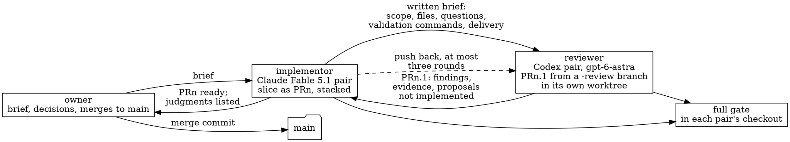

# Process record: an implementor agent, a reviewer agent, and pull requests

Sent: 2026-10-12

From: the `maintenance` workstream of the DevCapsule repository
(`github.com/ccozianu/devcapsule`), to `project-management` of this
project, at the owner's request. The sender is another repository, which
the workflow does not foresee; the owner asked for the message to be
delivered this way, so it travels as an ordinary intake item.

## What is handed over

A record of the process by which DevCapsule's persistent session
diagnostics were built on 2026-10-11: one agent implements, a second agent
reviews, the owner decides, and GitHub pull requests carry every step. The
owner wants this process to inform the development of this project, whose
debates between LLMs today run through API keys and Python clients.

## Why it belongs to this workstream

`project-management` owns what is worked on and how; the debate engines and
the portfolio application are its to sequence. This item carries no
priority and no release target. It is input, not an assignment.

## The process

1. The owner gives a brief in chat. The implementor restates it, names the
   components and the open choices, and starts when the owner says so.
2. The implementor builds one slice on a branch and opens PRn. A second
   slice stacks on the first branch. The pull request body carries a
   diagram, what changed, the judgments taken for the owner's review, and
   the validation with counts and limits.
3. The implementor writes a brief for the reviewer: the goal, what to read
   first and in which order, what the change does, what to look for
   (correctness, clarity, coverage), what not to widen, the validation
   commands verbatim, the commit authorship rule, the delivery commands,
   and a final line to print. The reviewer runs detached in its own git
   worktree with its own virtual environment, so it cannot disturb the
   implementor's checkout.
4. The reviewer writes PRn.1: a branch off PRn's branch, a pull request
   against PRn's branch, small commits, and a body with findings grouped by
   kind, the validation it ran with counts, and proposals it did not
   implement.
5. The implementor reads the diff, not only the summary, posts an
   assessment as a pull-request comment labeled by pair, and merges PRn.1
   into PRn's branch or pushes back with a new brief. At most three rounds
   per PR; then the owner is asked.
6. The implementor runs the full gate on the merged branch, including the
   check the reviewer's worktree cannot run, records the counts, and hands
   PRn to the owner. Only the owner merges to `main`, as a merge commit.
7. Every step is recorded: the workstream's status file, the evidence
   directory with real-session artifacts, the pull-request comments, and the
   memory the implementor keeps for the next session.

## What it produced

| Round | Kind of findings | Outcome |
|---|---|---|
| PR1.1, #208 | five real gaps: partial lines never reached the console, a drain delayed signal forwarding, an override never entered the container, an unusable directory produced an empty bind, an access log could persist tokens | merged without a round |
| PR2.1, #210 | four fixes; three proposals naming a thread outside the supervisor's signal mask and an exit the supervisor reaped first | merged; the proposals became a design change |
| PR2.2, #211 | no runtime defect; tests of SIGTERM and SIGKILL under the real supervisor, hostile paths, the privilege wrap | merged |
| PR2.3, #212 | failure paths: compress before expiring history, archive gaps, short writes, a second failure while closing; the docs' claims corrected | merged; rounds exhausted |

Between rounds the owner changed the design once, from an external
rotator to rotation in the writer. The loop absorbed it: one commit, one
more round, the same records.

## What we learned

- The brief is the reviewer's only context. What the brief leaves out, the
  reviewer does not know. A brief that lists the files in reading order and
  asks concrete questions gets concrete findings.
- A reviewer that runs its own gate and reports counts and limits ("the
  documentation contract was skipped because the website submodule is not
  initialized") is trustworthy. One that only summarizes is not.
- "Proposals not implemented" is the most valuable section. The reviewer's
  strongest findings were about lifecycle and failure: signals, reaping,
  crashes mid-rotation. Twice a proposal was a defect in the design.
- The implementor must read the diff. Twice the summary was right and the
  diff needed a merge decision the summary did not state.
- Accepting a review without a round and pushing back are both decisions
  with reasons; both go into the record. That matches this project's
  distinction between a reasoned concession and a capitulation.
- A rebase of a stacked branch's base on GitHub rewrites history the
  branches above it carry; merge commits keep a stack consistent.
- Cost: a round took twenty to forty minutes of wall time, most of it the
  reviewer's own gate. Three rounds per pull request was enough every time.

## How this may inform the trading-research project

The two loops have the same shape. This project rotates engines through
ANSWERER, CRITIC and SYNTHESIZER; the process above rotates an implementor,
a reviewer and the owner. The differences are the medium and the engines.

1. The medium. Here the rebuttal is a diff and the transcript is a pull
   request with comments attributed to a pair. A debate whose claims are
   files in a repository could use the same medium: the critic's output as
   a branch against the answerer's branch, so what changed is exact and
   reviewable, and the synthesis as the merge decision with its reasons.
2. The engines. This project calls providers through API clients with keys
   in the environment. The process above used local coding agents, the
   `codex` and `claude` command lines, signed in once in the capsule, with
   no key in any environment and with the repository as the context packet:
   the agent reads the files it is pointed at. A fourth engine kind backed
   by such an agent would sit beside the API clients, with these
   trade-offs: no key handling; the agent can read the repository and run
   its tools; slower per call; tool use that is not deterministic; cost
   accounted by subscription rather than per token. The browse tooling this
   project requires exists on both sides.
3. Bounded rounds and recorded outcomes. The three-round cap, the
   assessment comment per round, and the "proposals not implemented" list
   map onto bounded rebuttals, logged concessions, and the disputes ledger.
4. Honest validation. The reviewer's counts and limits are what this
   project calls an observed state: what ran, what did not, never a score.

None of this is a decision. The owner asked that it inform the work; the
form it takes here is this workstream's and the owner's to choose.

## Evidence

- Pull requests on `ccozianu/devcapsule`: #207 and #209 (the slices), #208,
  #210, #211 and #212 (the reviews), with the assessment comments.
- The maintenance status file,
  `engineering-docs/wip/2026-09-18-maintenance/CURRENT-STATUS.md`, entries
  of 2026-10-11, and its evidence directory
  `engineering-docs/wip/2026-09-18-maintenance/evidence/2026-10-11-session-logs/`.
- The reviewer's briefs were files in the implementor's session scratchpad;
  their structure is the one in step 3 above.

## What accepting this means

`project-management` records it as input to the debate engines and the
portfolio application, with no obligation beyond the record. The sender
does not assign priority, sequence, or a release target.
